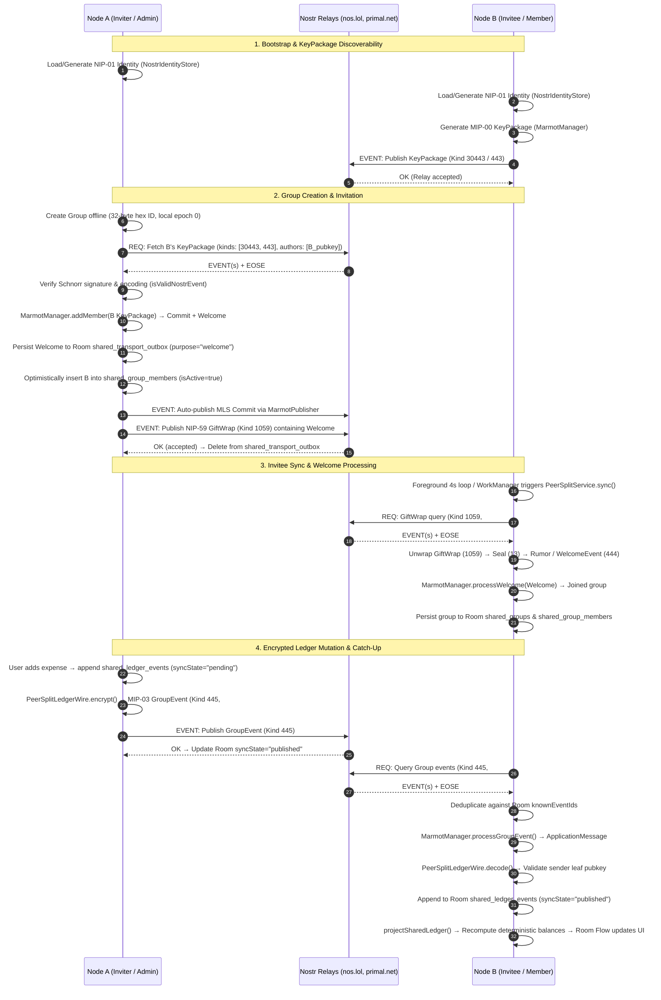

# Suvidha Architecture — Node ↔ Relay Protocol & Membership Specification

> **Status:** Fully verified against the native Android codebase (`app/src/main/java/com/just_sri/suvidha/expenses/`) and official membership rules (`app/rules/group_membership_rules.yaml`).
> **Scope:** End-to-end interactions between Android client nodes, Nostr relays, local Room SQLite persistence, and Messaging Layer Security (MLS) cryptographic state via Marmot/Quartz.

---

## 1. Actors and Ownership Boundaries

| Actor / Component | Owns & Enforces | Does Not Own |
|---|---|---|
| **Android Node (Device)** | Long-term Nostr identity (`KeyPair`), MLS group ratchet tree, local Room database, Keystore-backed secrets, sync cursor & pending outbox. | Remote peer private keys or relay storage policies. |
| **Nostr Relays** (`nos.lol`, `relay.primal.net`) | Ephemeral WebSocket connections; indexing and forwarding signed events (`EVENT`, `REQ`, `EOSE`, `OK`) subject to relay retention. | MLS decryption, plaintext visibility, financial balances, group membership decisions. |
| **`PeerSplitService`** | Mutex-serialized MLS group lifecycle (`createGroup`, `invite`, `removeMember`), ledger mutation coordinator (`mutateLedger`), outbox persistence. | Direct network socket I/O. |
| **`MarmotManager` (MLS Core)** | Tree cryptographic state, epoch transitions, Commit/Welcome generation & consumption, ratchet forward secrecy, transport obligation store. | UI rendering, Room SQLite transactions, financial domain logic. |
| **`PeerSplitRelaySync`** | Relay connection pool, parallel publishing (`publishOne`), batch queries (`query`), event signature verification (`isValidNostrEvent`), GiftWrap unwrapping. | Deciding whether an invitation or membership transition is legally permitted. |
| **`PeerSplitLedgerWire`** | Wire format serialization/deserialization (`suvidha.shared-ledger` v1) between domain `SharedLedgerEvent` and inner rumor text messages. | Cryptographic key derivation or transport delivery. |
| **Room Repositories** (`SharedGroupRepository`, `ExpenseRepository`) | Durable SQLite tables (`shared_groups`, `shared_group_members`, `shared_ledger_events`, `shared_transport_outbox`), reactive `Flow` projections. | Network authority or MLS state derivation. |
| **`PeerSplitSyncScheduler` & `PeerSplitSyncWorker`** | Background sync scheduling via Android WorkManager (15-min periodic + change-triggered immediate sync). | Instant foreground delivery guarantees. |

**Trust Boundary:** Nostr relays are treated as zero-trust public infrastructure. Relays observe only event timestamps, IP addresses, Nostr pubkeys, and routing tags (`#p`, `#h`). All expense notes, financial amounts, personal notes, and chat payloads are encrypted end-to-end under MLS or NIP-59 seals before network transmission. Relay `OK` signifies relay acceptance, **not** recipient delivery or application confirmation.

---

## 2. Complete Protocol Flow



---

### 2.1 Identity and KeyPackage Discovery

1. **Identity Generation & Storage:**
   - Every node maintains a NIP-01 secp256k1 keypair managed by [`NostrIdentityStore`](file:///Users/srikant/Documents/srikant/suvidha/frontend/app/src/main/java/com/just_sri/suvidha/expenses/NostrIdentityStore.kt).
   - Long-term private keys are encrypted at rest using an AES-256-GCM master key protected by the hardware-backed Android Keystore.
2. **KeyPackage Publication (MIP-00):**
   - When the user toggles "Group Invitations" in Profile, [`publishInviteKey()`](file:///Users/srikant/Documents/srikant/suvidha/frontend/app/src/main/java/com/just_sri/suvidha/expenses/PeerSplitService.kt#L40-L46) calls `MarmotManager.generateKeyPackageEvent(relays, "primary", false)`.
   - The signed event is published to `DEFAULT_RELAYS` (`wss://nos.lol`, `wss://relay.primal.net`) under kinds `30443` (parameterized replaceable) and `443` (legacy/ephemeral).
   - Matching private KeyPackage secrets are persisted securely in [`EncryptedKeyPackageBundleStore`](file:///Users/srikant/Documents/srikant/suvidha/frontend/app/src/main/java/com/just_sri/suvidha/expenses/EncryptedKeyPackageBundleStore.kt).
3. **KeyPackage Retrieval:**
   - To invite peer `B`, `A` calls [`fetchKeyPackageEvents(publicId)`](file:///Users/srikant/Documents/srikant/suvidha/frontend/app/src/main/java/com/just_sri/suvidha/expenses/PeerSplitRelaySync.kt#L148-L162) with Nostr filter:
     ```json
     { "kinds": [30443, 443], "authors": ["<64-char-hex-pubkey>"], "limit": 20 }
     ```
   - Events are validated via [`isValidNostrEvent()`](file:///Users/srikant/Documents/srikant/suvidha/frontend/app/src/main/java/com/just_sri/suvidha/expenses/PeerSplitRelaySync.kt#L246-L252) (checking SHA-256 event ID and Schnorr signature via `Nip01Crypto.verify`).
   - If no valid KeyPackage is returned, the invitation aborts with: *"No invite key found. Ask this friend to enable group invitations in Profile, then retry."*

---

### 2.2 Group Creation & Member Invitation

1. **Local Group Initialization:**
   - [`createGroup(name, currencyCode)`](file:///Users/srikant/Documents/srikant/suvidha/frontend/app/src/main/java/com/just_sri/suvidha/expenses/PeerSplitService.kt#L48-L58) generates a 32-byte cryptographic random hex ID (`ByteArray(32).also(SecureRandom()::nextBytes).joinToString("") { "%02x".format(it) }`).
   - Initialized in Marmot with `MarmotGroupData` storing `nostrGroupId`, name, description (`suvidha.currency=<ISO>`), admin pubkey, and configured relay URLs.
   - Inserted atomically into Room [`shared_groups`](file:///Users/srikant/Documents/srikant/suvidha/frontend/app/src/main/java/com/just_sri/suvidha/expenses/ExpenseData.kt#L99-L106) and [`shared_group_members`](file:///Users/srikant/Documents/srikant/suvidha/frontend/app/src/main/java/com/just_sri/suvidha/expenses/ExpenseData.kt#L108-L128) (`role = "owner"`, `isActive = true`).
2. **Adding a Member (`invite`):**
   - Inviter executes [`MarmotManager.addMember(groupId, keyPackageEvent, relays)`](file:///Users/srikant/Documents/srikant/suvidha/frontend/app/src/main/java/com/just_sri/suvidha/expenses/PeerSplitService.kt#L69).
   - Generates an MLS Add Commit and a Welcome message encapsulated in a NIP-59 GiftWrap (`GiftWrapEvent`, Kind `1059`).
   - **Outbox Persistence:** The GiftWrap JSON is queued in [`shared_transport_outbox`](file:///Users/srikant/Documents/srikant/suvidha/frontend/app/src/main/java/com/just_sri/suvidha/expenses/ExpenseData.kt#L157-L166) with `purpose = "welcome"`.
   - Member is recorded in [`shared_group_members`](file:///Users/srikant/Documents/srikant/suvidha/frontend/app/src/main/java/com/just_sri/suvidha/expenses/SharedGroupRepository.kt#L216-L234) with `role = "member"`, `isActive = true`.
   - Immediate publish is attempted over WebSockets. Upon relay `OK`, [`markWelcomePublished()`](file:///Users/srikant/Documents/srikant/suvidha/frontend/app/src/main/java/com/just_sri/suvidha/expenses/SharedGroupRepository.kt#L192) purges the item from `shared_transport_outbox`. If offline, delivery is retried by [`PeerSplitSyncScheduler`](file:///Users/srikant/Documents/srikant/suvidha/frontend/app/src/main/java/com/just_sri/suvidha/expenses/PeerSplitSyncScheduler.kt).

---

### 2.3 Invitation Toggle Semantics

- **Enabled (`groupInvitationsEnabled = true`):**
  - Generates and publishes an ephemeral MIP-00 KeyPackage to Nostr relays.
  - Allows peer nodes to fetch the KeyPackage and generate a Welcome envelope.
- **Disabled (`groupInvitationsEnabled = false`):**
  - Updates local `SharedPreferences`. Prevents automatic regeneration/re-publication of KeyPackages.
- **Invitee Processing Lifecycle:**
  - On sync, the node queries Nostr relays for GiftWrap events (`Kind 1059`) tagged with `#p = <own_pubkey>`.
  - Unwraps: `GiftWrapEvent` (Kind 1059) → `SealEvent` (Kind 13) → `WelcomeEvent` (Kind 444).
  - Validates `rumor.pubKey == seal.pubKey`.
  - Ingests via `MarmotManager.processWelcome(welcome)`. On `WelcomeResult.Joined`, persists the joined group and member roster to Room (`createJoinedGroup`).

---

### 2.4 Ledger Wire Format, Actions & Projection

1. **Wire Format ([`PeerSplitLedgerWire`](file:///Users/srikant/Documents/srikant/suvidha/frontend/app/src/main/java/com/just_sri/suvidha/expenses/PeerSplitLedgerWire.kt)):**
   Domain actions are serialized into a strict JSON envelope before Marmot encryption:
   ```json
   {
     "protocol": "suvidha.shared-ledger",
     "version": 1,
     "eventId": "UUID",
     "groupId": "32-byte-hex-string",
     "actorMemberId": "64-char-hex-pubkey",
     "occurredAtMillis": 1740000000000,
     "description": "Lunch split",
     "parentEventIds": ["UUID1", "UUID2"],
     "actionType": "expense_added",
     "action": { ... }
   }
   ```
2. **Supported Domain Actions ([`SharedLedgerAction`](file:///Users/srikant/Documents/srikant/suvidha/frontend/app/src/main/java/com/just_sri/suvidha/expenses/SharedLedger.kt#L16-L31)):**
   - `ExpenseAdded(currencyCode, debts: List<SharedDebtUnit>)`: Defines creditor, debtor, and exact integer amounts in minor currency units (e.g., paise/cents).
   - `SettlementRecorded(allocations: List<SharedSettlementAllocation>)`: Records payments allocating portions of specific active debt units.
   - `DebtRemoved(debtUnitId)`: Zeroes out an outstanding debt unit.
   - `ChatMessage(text)`: Peer-to-peer encrypted group chat (up to 2,000 characters).
3. **Split Cancellation Mechanism:**
   - When a split is cancelled, the event description in `shared_ledger_events` is updated to append `(Cancelled)`.
   - In [`projectSharedLedger()`](file:///Users/srikant/Documents/srikant/suvidha/frontend/app/src/main/java/com/just_sri/suvidha/expenses/SharedLedger.kt#L149-L153), any `ExpenseAdded` action whose description contains `(Cancelled)` is accepted into causal history, but its debts are **not** instantiated, completely zeroing out its debt impact on balances.
   - In UI, [`resolveSplitStatus()`](file:///Users/srikant/Documents/srikant/suvidha/frontend/app/src/main/java/com/just_sri/suvidha/expenses/ui/SplitExpenseCard.kt#L38-L56) evaluates this to `SplitStatus.CANCELLED`.
4. **Deterministic Replay ([`projectSharedLedger`](file:///Users/srikant/Documents/srikant/suvidha/frontend/app/src/main/java/com/just_sri/suvidha/expenses/SharedLedger.kt#L65-L264)):**
   - Validates event causal graphs (DAG). Ancestors must be accepted before descendants.
   - Resolves concurrency and ties using deterministic event ID sorting.
   - Detects cycles using Kahn's algorithm (cycles are rejected).
   - Aggregates balances using exact integer arithmetic (`Math.addExact` / `Math.subtractExact`).

---

### 2.5 Transport, Sync & Reconnection Mechanics

- **No Long-Lived WebSocket Subscriptions:**
  - Suvidha avoids persistent background WebSocket connections to save battery and comply with Android background execution limits.
  - [`PeerSplitRelaySync.query()`](file:///Users/srikant/Documents/srikant/suvidha/frontend/app/src/main/java/com/just_sri/suvidha/expenses/PeerSplitRelaySync.kt#L192-L231) connects, issues `REQ`, collects events, awaits `EOSE`, sends `CLOSE`, and cleanly terminates the socket (`1000 "sync complete"`).
- **Foreground Synchronization:**
  - In [`GroupsScreen.kt`](file:///Users/srikant/Documents/srikant/suvidha/frontend/app/src/main/java/com/just_sri/suvidha/expenses/ui/GroupsScreen.kt#L159-L166), active screens run a lifecycle-aware coroutine loop (`repeatOnLifecycle(Lifecycle.State.RESUMED)`) polling `model.backgroundSync()` every 4 seconds.
  - On app resume, [`SuvidhaApp.kt`](file:///Users/srikant/Documents/srikant/suvidha/frontend/app/src/main/java/com/just_sri/suvidha/expenses/ui/SuvidhaApp.kt#L34) calls `model.onResume()`.
- **Background Synchronization:**
  - Scheduled via [`PeerSplitSyncScheduler`](file:///Users/srikant/Documents/srikant/suvidha/frontend/app/src/main/java/com/just_sri/suvidha/expenses/PeerSplitSyncScheduler.kt) using Android `WorkManager`:
    - Periodic work: `PeriodicWorkRequestBuilder<PeerSplitSyncWorker>(15, TimeUnit.MINUTES)` with exponential backoff (30s).
    - Immediate work: `OneTimeWorkRequestBuilder<PeerSplitSyncWorker>()` enqueued on local mutations with `ExistingWorkPolicy.APPEND_OR_REPLACE`.
- **Concurrency & Ratchet Protection:**
  - All MLS cryptographic tree operations, Keystore access, and sync mutations are strictly serialized under [`PeerSplitService.protocolMutex`](file:///Users/srikant/Documents/srikant/suvidha/frontend/app/src/main/java/com/just_sri/suvidha/expenses/PeerSplitService.kt#L214).
  - Background workers use [`syncIfIdle()`](file:///Users/srikant/Documents/srikant/suvidha/frontend/app/src/main/java/com/just_sri/suvidha/expenses/PeerSplitService.kt#L100-L103) (`tryLock`) to avoid blocking interactive UI operations.

---

## 3. Relay Rules, Kinds & Wire Filters

| Protocol Entity | Nostr Kind | Wire Filter / Tags | Payload Encoding |
|---|---|---|---|
| **MIP-00 KeyPackage** | `30443` (replaceable), `443` (ephemeral) | `authors: [<pubKeyHex>]`, `limit: 20` | Plaintext signed Nostr event containing public MLS KeyPackage bytes |
| **NIP-59 GiftWrap** | `1059` | `#p: [<recipientPubKeyHex>]`, `limit: 500` | Encrypted envelope wrapping Seal (Kind 13) |
| **MIP-02 Welcome** | `444` (rumor inside Seal) | Embedded inside GiftWrap/Seal | Marmot MLS Welcome structure |
| **MIP-03 Group Event** | `445` | `#h: [<groupIdHex>]`, `limit: 2000` | Encrypted MLS ciphertext containing signed inner application rumor |

### Default Relays & Network Timeouts
- **Default Relay Pool:** [`DEFAULT_RELAYS`](file:///Users/srikant/Documents/srikant/suvidha/frontend/app/src/main/java/com/just_sri/suvidha/expenses/PeerSplitRelaySync.kt#L241-L244):
  - `wss://nos.lol`
  - `wss://relay.primal.net`
- **Socket Timeouts:**
  - OkHttpClient connect timeout: 8 seconds.
  - Event publishing timeout: 12 seconds per attempt (`withTimeoutOrNull(12_000)`).
  - Relay query batch timeout: 18 seconds (`withTimeoutOrNull(18_000)`).
  - WorkManager execution timeout: 4 minutes (`withTimeout(4 * 60_000L)`).
- **Deduplication:**
  - Events are deduplicated against Room records (`knownEventIds`) and Marmot's `ingestDedupStore` in [`EncryptedMarmotTransportStore`](file:///Users/srikant/Documents/srikant/suvidha/frontend/app/src/main/java/com/just_sri/suvidha/expenses/EncryptedMarmotTransportStore.kt).

---

## 4. Code Structure & Component Responsibilities

```
app/src/main/java/com/just_sri/suvidha/expenses/
├── ui/
│   ├── AppViewModel.kt              # Presentation state holder, intent dispatching, background sync triggers
│   ├── GroupsScreen.kt              # Groups overview, roster management, add/remove member dialogs, 4s polling
│   ├── SplitDetailScreen.kt         # Split breakdown, settlement triggers, split cancellation
│   ├── SplitExpenseCard.kt          # Split status badge resolution (ACTIVE / CANCELLED)
│   └── ChatScreen.kt                # Encrypted group messaging timeline & composer
├── PeerSplitService.kt              # High-level MLS orchestrator, protocolMutex serialization
├── PeerSplitRelaySync.kt            # Nostr transport client (OkHttp WebSockets, REQ/EVENT/EOSE/CLOSE)
├── PeerSplitLedgerWire.kt           # "suvidha.shared-ledger" JSON wire envelope encoder/decoder
├── PeerSplitSyncScheduler.kt        # WorkManager registration (periodic 15-min and one-shot APPEND_OR_REPLACE)
├── PeerSplitSyncWorker.kt           # CoroutineWorker executing syncInBackground with 4-min timeout
├── SharedLedger.kt                  # Domain types, immutable DAG replay, projectSharedLedger() projection
├── SharedLedgerCodec.kt             # Domain action JSON encoder/decoder
├── SharedSplitMoney.kt              # Minor currency formatting (avoids floating-point imprecision)
├── NostrIdentityStore.kt            # Keystore-backed NIP-01 secp256k1 keypair persistence
├── EncryptedMlsGroupStateStore.kt   # Encrypted MLS epoch tree and Marmot state storage
├── EncryptedKeyPackageBundleStore.kt# Encrypted private MIP-00 KeyPackage bundle storage
├── EncryptedMarmotTransportStore.kt # Marmot publish obligations and ingest deduplication storage
├── ExpenseData.kt                   # Room Database, DAOs, entities, and migration definitions (version 4)
├── SharedGroupRepository.kt         # Group persistence, outbox management, member roster syncing
└── NotificationService.kt           # Android system notifications for remote group expenses & settlements
```

---

## 5. Non-Negotiable Invariants

1. **Zero-Trust Network:** No plaintext financial amounts, notes, chat messages, or private keys are ever sent to Nostr relays. All payloads must be encrypted under MLS or NIP-59 before network egress.
2. **Local-First Durability:** All user actions (creating expenses, adding splits, sending chat) must be committed to Room SQLite before scheduling network synchronization. Relay failure or lack of internet connectivity must never block local state progression.
3. **Deterministic Balance Projection:** Balances are never maintained as mutable columns or counters in Room. Balances are derived purely and deterministically by replaying causal `SharedLedgerEvent` streams via [`projectSharedLedger()`](file:///Users/srikant/Documents/srikant/suvidha/frontend/app/src/main/java/com/just_sri/suvidha/expenses/SharedLedger.kt#L65).
4. **Integer Currency Arithmetic:** Financial calculations are strictly performed in minor units (e.g. paise/cents) using `Long`, `Math.addExact`, and `Math.subtractExact`. Floating-point (`Double`) is strictly forbidden for shared ledger math.
5. **Strict Mutex Serialization:** All MLS cryptographic tree transitions, ratchet updates, and ledger mutations must run under [`PeerSplitService.protocolMutex`](file:///Users/srikant/Documents/srikant/suvidha/frontend/app/src/main/java/com/just_sri/suvidha/expenses/PeerSplitService.kt#L214) to prevent concurrent ratchet desynchronization.
6. **Relay Acknowledgment Semantics:** Relay `OK` confirms only that the relay accepted the event into its local store. It does **not** signify that recipient peers have downloaded, decrypted, or applied the message.

---

## 6. Group Membership & Departure Rules

The rules governing member self-exit and admin removal strictly implement [`app/rules/group_membership_rules.yaml`](file:///Users/srikant/Documents/srikant/suvidha/frontend/app/rules/group_membership_rules.yaml).

### 6.1 Member Self-Exit (Leaving the Group)

- **Preconditions:**
  - Caller must be an active group member (`isActive: true`).
  - If caller is the group owner, they cannot leave while other active members exist without transferring ownership or closing the group.
- **Confirmation Dialog:**
  - **Title:** `"Leave group?"`
  - **Message:** `"You will be removed from this group. Any active splits created by you will be marked as CANCELLED."`
  - **Confirm Action:** `"Leave group"` (destructive style)
  - **Dismiss Action:** `"Cancel"` (neutral style)
- **Causal Ledger & Cryptographic Effects:**
  1. **Cancel Authored Splits:** All active split expenses authored by the departing member in this group transition to `SplitStatus.CANCELLED`. Their description is updated to append `(Cancelled)`. In [`projectSharedLedger()`](file:///Users/srikant/Documents/srikant/suvidha/frontend/app/src/main/java/com/just_sri/suvidha/expenses/SharedLedger.kt#L149), active debt calculations and balances associated with these splits are removed from the shared ledger.
  2. **Deactivate Member:** Target member's active status transitions to `isActive = false` in [`shared_group_members`](file:///Users/srikant/Documents/srikant/suvidha/frontend/app/src/main/java/com/just_sri/suvidha/expenses/ExpenseData.kt#L127).
  3. **Timeline Notice:** A system activity notice is appended to the timeline: `"<Member Name> left the group"`.
  4. **MLS Removal:** Generates and distributes an MLS Remove Commit, advancing the group epoch and excluding the departing node from future epoch secrets.

---

### 6.2 Owner-Initiated Member Removal (Admin Removal)

- **Preconditions:**
  - Caller must be the group owner/admin (`role == "owner"`).
  - Target must be an active member (`isActive: true`) and cannot be the owner.
  - **Strict Zero-Balance & No-Debt Requirement:**
    - Target's net balance must equal 0 (`netBalanceMinor == 0`).
    - **No Outstanding Loans:** Target must not owe any money to any group member (`debtorMemberId == target && remainingAmountMinor > 0` must be empty).
    - **No Active Mortgages:** No group member can owe any money to target (`creditorMemberId == target && remainingAmountMinor > 0` must be empty).
    - Net zero alone is insufficient because opposing debts cannot be assumed to cancel across distinct parties.
- **Validation Failure:**
  - If any debt remains unsettled, the operation aborts with error:
    *"Cannot remove member: All outstanding balances and debts involving <Member Name> must be settled first."*
- **Confirmation Dialog:**
  - **Title:** `"Remove member?"`
  - **Message:** `"<Member Name> will be removed from <Group Name>. Their balance has been settled."`
  - **Confirm Action:** `"Remove"` (destructive style)
  - **Dismiss Action:** `"Cancel"` (neutral style)
- **Causal Ledger & Cryptographic Effects:**
  1. **MLS Remove Commit:** [`PeerSplitService.removeMember()`](file:///Users/srikant/Documents/srikant/suvidha/frontend/app/src/main/java/com/just_sri/suvidha/expenses/PeerSplitService.kt#L80-L90) executes `MarmotManager.removeMember(groupId, member.leafIndex, relays)`.
  2. **Epoch Advance:** Issues a Remove Commit to remaining members. The removed member is cryptographically barred from decrypting subsequent group epochs.
  3. **Deactivate Member:** Member is marked `isActive = false` in `shared_group_members`.
  4. **Timeline Notice:** Emits timeline event: `"<Member Name> was removed by group admin"`.

---

### 6.3 Post-Departure Restrictions

- **Read-Only Ledger Status:** Inactive or departed members cannot publish new expenses, record settlements, or send chat messages. Receiving nodes reject any unauthorized events from inactive keys.
- **Historical Attribution:** Past messages, settled transactions, and ledger history involving departed members are preserved with the label **"Former member"**.
- **Historical Key Privacy:** MLS prevents departed members from accessing **future epoch secrets**. Relays may retain previously broadcast ciphertext; client nodes maintain local audit history.
