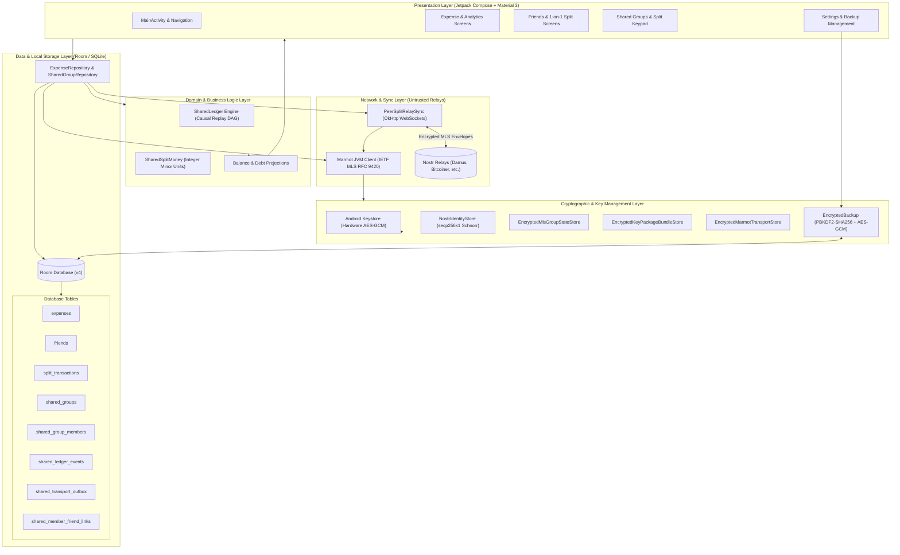
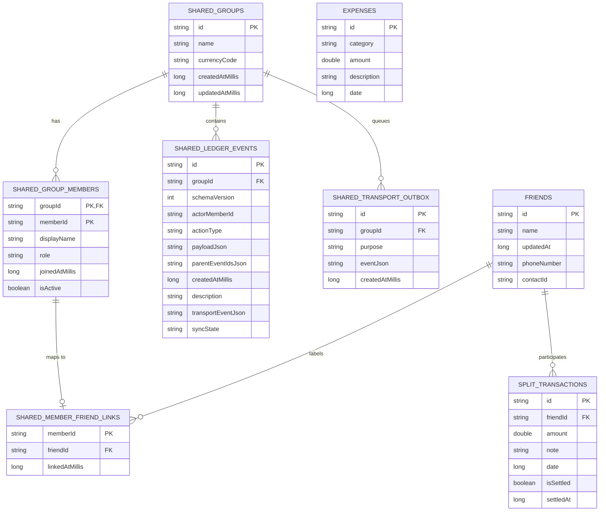
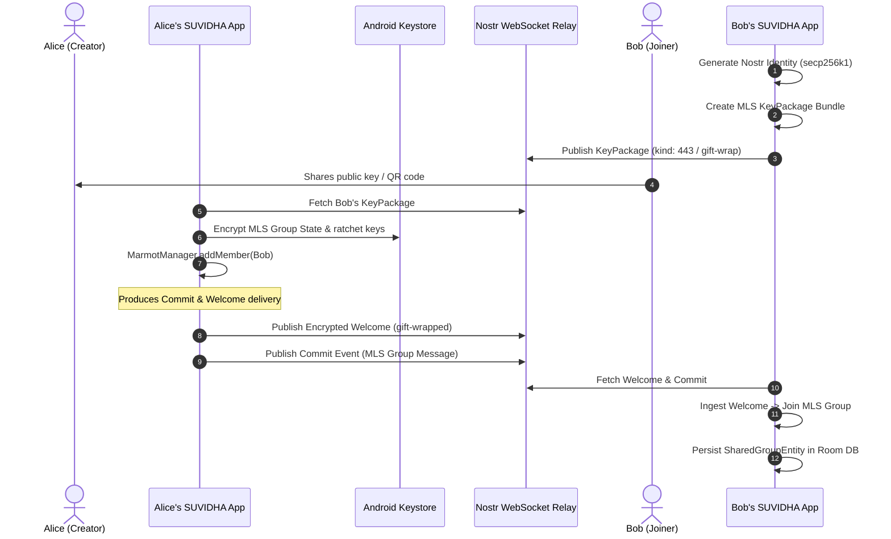
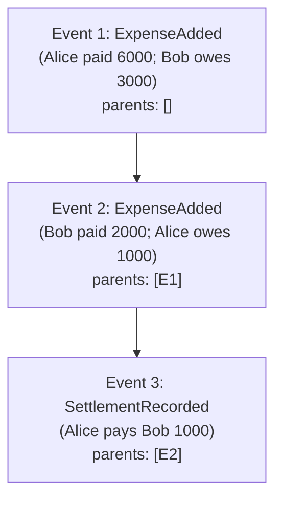

# SUVIDHA — System Architecture & Design Specification

> **Version:** 1.0.3 (Database Schema v4)  
> **Status:** Active / Production & PeerSplit Protocol Prototype  
> **Target Platform:** Android (minSdk 26, compileSdk 37, targetSdk 36)  
> **Core Tech:** Kotlin, Jetpack Compose (Material 3), Room DB, Coroutines/StateFlow, Marmot/MLS, Nostr

---

## 1. Executive Summary

**SUVIDHA** is an offline-first personal expense tracking and decentralized group bill-splitting application for Android. 

The application is structured into two complementary domains:
1. **Personal Finance Tracking:** 100% offline personal expense logging, custom categories, analytics, and direct 1-on-1 friend split ledgers.
2. **PeerSplit (Decentralized Group Sharing):** Private, multi-device group expense splitting operating without centralized servers or cloud user accounts. PeerSplit utilizes IETF MLS (RFC 9420) through the Marmot protocol over untrusted Nostr relays to guarantee end-to-end encrypted group consensus, causal ledger replay, and local address-book isolation.

### Architectural Core Principles
- **Offline-First & Local Authority:** The local SQLite/Room database is always the authoritative source of truth. The UI reacts solely to Room queries via reactive coroutine `Flow` streams. Network relays are treated as untrusted, asynchronous mailboxes.
- **No Floating-Point Money:** All shared financial figures are tracked strictly in integer minor units (`Long` paise/cents) with deterministic remainder distribution algorithms to eliminate rounding drift.
- **Append-Only Causal Ledger:** Balances are not stored as mutable values on the wire. Instead, state is reconstructed by replaying an immutable Directed Acyclic Graph (DAG) of domain events with causal parent tracking.
- **Zero Metadata Leakage to Relay:** Contact names, phone numbers, and address-book linkages remain strictly on the local device. Relays receive only encrypted MLS envelopes.
- **Verifiable & Resilient Migrations:** Database schema evolves through deterministic Room `Migration` steps (v1 → v2 → v3 → v4) with byte-level row verification and fallback safeguards.

---

## 2. High-Level System Architecture



---

## 3. Data Architecture & Schema Evolution

The local database is named `suvidha-expenses.db` and is managed by Room.

### 3.1 Room Schema Evolution
- **Schema v1:** Baseline single-device tables: `expenses`, `friends`, and `split_transactions`.
- **Schema v2:** Added `shared_groups`, `shared_group_members`, and `shared_ledger_events` for decentralized tracking.
- **Schema v3:** Added `shared_transport_outbox` for resilient store-and-forward relay sync and added `description` / `transportEventJson` / `syncState` to `shared_ledger_events`.
- **Schema v4:** Added `shared_member_friend_links` to cleanly isolate local friend/contact identities from cryptographic public keys.

### 3.2 Database Entities & Relationships



### 3.3 Privacy Firewall: `shared_member_friend_links`
A critical architectural constraint in SUVIDHA is the **Address Book Isolation Principle**:
- Nostr relays and peer devices only exchange cryptographic member IDs (`memberId`, which is the hex public key of the actor).
- The user's personal address book labels (e.g. "Mom", "Roommate Dave", phone numbers, Android `contactId`) are stored in `friends` and linked via `shared_member_friend_links`.
- **Wire Guarantee:** No personal phone numbers, device contacts, or local friend names are ever packaged into MLS application payloads or Nostr relay events.

---

## 4. PeerSplit Protocol & Cryptographic Engine

PeerSplit solves multi-device expense synchronization without requiring centralized databases, user authentication servers, or account credentials.

### 4.1 Cryptographic Primitives & Tech Stack
- **Nostr Signer:** Schnorr signatures over secp256k1 (NIP-01 compliant). Managed by `NostrIdentityStore`.
- **Hardware Keystore Protection:** Private keys and state store envelopes are encrypted using Android Keystore-backed AES-256-GCM.
- **Group Key Agreement & Epochs:** IETF MLS (RFC 9420) via `com.vitorpamplona.marmot:marmot-jvm:2.2.1`.
- **Marmot Integration:** Combines Nostr relays as an untrusted message broker with MLS for authenticated group messaging, ratcheted epoch keys, and cryptographic forward secrecy.



### 4.2 Application Message Envelope
Shared ledger updates travel inside MLS Application Messages (`suvidha.shared-ledger`, schema version 1). 
- An inner rumor event is created containing the ledger action JSON.
- The inner event is encrypted and signed through the MLS tree state (`buildGroupMessage`).
- The outer event is an encrypted Nostr Group Message, signed with the sender's Nostr key and addressed to the group conversation topic.

### 4.3 Transactional Outbox Pattern
To prevent split-brain state between local Room storage and network relay publication:
1. When the user creates an expense or records a settlement, Room executes a single atomic transaction:
   - Inserts `SharedLedgerEventRecord` with `syncState = 'pending'`.
   - Inserts encrypted message into `SharedTransportOutboxEntity`.
2. The UI immediately reflects the changes via reactive balance projection.
3. `PeerSplitRelaySync` reads from the outbox, broadcasts to configured relays, and upon receiving relay ACK:
   - Removes entry from `SharedTransportOutboxEntity`.
   - Updates `SharedLedgerEventRecord.syncState = 'published'`.

---

## 5. Financial Calculation & Balance Projection Engine

### 5.1 Minor Units Engine (`SharedSplitMoney.kt`)
To guarantee mathematical invariants across different Android runtime architectures, floating-point calculations (`Float`, `Double`) are prohibited in the shared ledger:
- All balances are held in `Long` minor units (e.g. ₹100.50 is represented as `10050L`).
- Calculations support standard decimal scale factors (typically 2 for INR, USD, EUR).

#### Deterministic Split Allocations
When an amount cannot be divided evenly among participants (e.g., ₹100.00 split among 3 members = ₹33.333...):
- **Equal Split:** Base allocation = $\lfloor \text{Total} / N \rfloor$. Remainder cents/paise are allocated deterministically (one minor unit each to the first $R$ members sorted by `memberId`).
- **By Shares:** Proportional distribution with deterministic remainder allocation to members with the largest fractional remainders.
- **Exact:** Explicit minor unit amounts assigned per member, enforced to sum exactly to the total.

### 5.2 Immutable Causal DAG Replay (`SharedLedger.kt`)



- Every event declares explicit `parentEventIds`.
- The projection function `projectSharedLedger(groupId, events, currencyCode)` executes deterministic topological ordering:
  1. Detects and excludes duplicate event IDs.
  2. Traverses causal dependencies, postponing any event whose parents have not yet been received.
  3. Sorts concurrent ready events by `eventId` as a deterministic tie-breaker.
  4. Maintains an active ledger of outstanding `SharedDebtUnit` records.
  5. Applies settlements against specific targeted debt unit IDs.
  6. Computes net member balances: $\sum \text{Credit} - \sum \text{Debit}$.

---

## 6. Encrypted Backup & Disaster Recovery

SUVIDHA provides a zero-cloud-dependent manual backup system via Android's Storage Access Framework (SAF).

### 6.1 Container Specification (`EncryptedBackup.kt`)

```text
+---------------------------------------------------------------------------------------+
| Magic (8B) | Ver(1B) | KDF(1B) | Iterations(4B) | Salt(16B) | Nonce(12B) | Ciphertext |
| 'SUVIDHA1' |  0x01   |  0x01   | 600,000 (BE)   |  Random   |  Random    | + GCM Tag  |
+---------------------------------------------------------------------------------------+
```

- **Header Magic:** ASCII `"SUVIDHA1"`.
- **KDF:** PBKDF2 with HMAC-SHA-256, 600,000 iterations (bounded between 600k and 1.2M).
- **Encryption:** AES-256-GCM (128-bit authentication tag).
- **Associated Data (AAD):** The entire fixed-length binary header is authenticated as GCM Associated Data. Any byte tampering in the header or ciphertext triggers immediate decryption failure before parsing.

### 6.2 Snapshot Payloads & Keystore Re-wrapping
- **Payload v1:** Personal expenses, friends, 1-on-1 splits.
- **Payload v2:** Added shared groups, members, and ledger events.
- **Payload v3:** Complete cryptographic protocol state, including:
  - Nostr private signing key.
  - MLS group state blobs and retained epoch ratchets.
  - Private KeyPackage bundle.
  - Outbox queues and member-friend linkages.
- **Atomic Restore:** Decryption validates the snapshot completely in memory, checks entity counts, stages Keystore credentials, and executes a single Room database transaction to replace tables with rollback on error.

---

## 7. Presentation & UI/UX Architecture

The user interface is built entirely with Jetpack Compose, following Material 3 guidelines and full Edge-to-Edge display support.

### 7.1 Screen Organization
- **Expenses Tab (`tab = 0`):** Monthly and category breakdown, daily grouping, search/filter, and floating action button to open `ExpenseFlowScreen`.
- **Friends Tab (`tab = 1`):** Personal 1-on-1 friend balances, ledger view (`FriendTransactionsPage`), settling splits, and phone contact linking via `ContactsScreen`.
- **Shared Groups Tab (`tab = 2`):** PeerSplit shared groups list (`SharedGroupsPage`), group detail, real-time sync status pill, customized split keypad with Equal/Exact/Shares modes (`SharedExpenseFlowScreen`), and friend-linking dialogs.
- **Settings Tab (`tab = 3`):** Categories manager, currency selector (₹, $, €, £), timezone configuration, and encrypted backup export/import (`BackupManagementPage`).

### 7.2 UI Theme Tokens (`ExpenseUiTheme.kt`)
- **Primary Tint:** Forest Green (`#1E5E3A`)
- **Canvas / Background:** Soft off-white (`#F9FBF8`)
- **Card Surface:** Clean white (`#FFFFFF`) with subtle border elevation (`#E5EBE3`)
- **Typography:** High-contrast Ink (`#1A211B`), muted supporting labels (`#5E6B61`)

---

## 8. Threat Model & Security Invariants

| Vector | Threat | Mitigation / Design Invariant |
|---|---|---|
| **Untrusted Relay** | Relay snoops on financial data or alters ledger entries. | All financial payloads are end-to-end encrypted with MLS before touching WebSockets. Signatures prevent tampering; relays cannot modify contents without failing GCM or Schnorr verification. |
| **Relay Traffic Analysis** | Relay inspects public metadata to infer relationships. | Relays observe message timing, size, and IP, but group member names, phone numbers, and local labels never appear in payloads or headers. |
| **Database Theft** | Attacker accesses phone storage / root filesystem. | Critical keys (Nostr private key, MLS group states, KeyPackages) are encrypted using Android Keystore AES-GCM before writing to storage. |
| **Tampered Backup** | Malicious file fed into manual restore flow. | Authenticated binary header (AAD) + AES-GCM tag verification rejects corrupt, modified, or re-wrapped payloads before SQLite writes begin. |
| **Concurrent Splits** | Out-of-order delivery from different network relays. | Causal event parent tracking ensures settlements are only applied once their parent expenses are ingested. Deterministic tie-breaking ensures identical final balances across all devices. |

---

## 9. Build Flavors & Verification Strategy

The repository supports dual product flavors built from a single codebase to enable live two-identity verification on physical devices without code changes:

- **`standard` Flavor:**
  - `applicationId`: `com.just_sri.suvidhaapp`
  - Manifest Label: `Suvidha Expenses`
  - Production Play Store deployment target.
- **`deviceTest` Flavor:**
  - `applicationId`: `com.just_sri.suvidhaapp.peersplitpreview`
  - Manifest Label: `Suvidha PeerSplit Test`
  - Can be co-installed on the same physical Android handset alongside the standard build to test peer discovery, invitation delivery, and dual-identity relay sync.

### Automated Test Matrix
1. **Unit Tests (12 tests):** Validates deterministic minor-unit split distribution, causal DAG resolution, invariant checks, and encrypted backup header validation.
2. **Device Instrumentation Tests (14 tests):** Runs on Android devices via AndroidJUnit4:
   - Schema migrations 1 → 2 → 3 → 4 with SQLite row digest comparisons.
   - Keystore secret wrapping and store restoration.
   - Live two-identity MLS invitation and commit exchanges.

